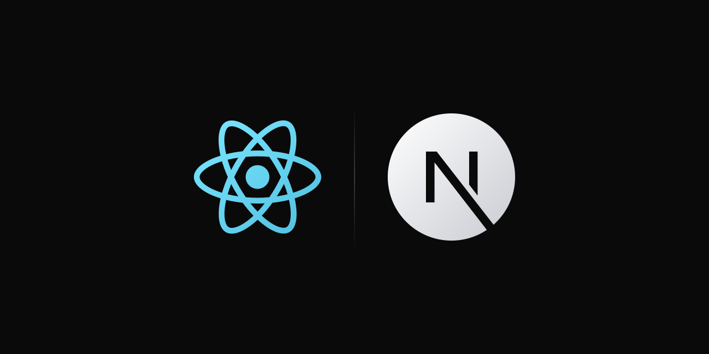

---

# ⚛️ Stack Frontend del Proyecto
A continuación se resumen las principales tecnologías del proyecto y el motivo por el que se utilizan. No se incluyen todas las dependencias.

## 🟢 Node.js 24.22.1

## [Next.js 16 con App Router (`app`)](https://youtu.be/_SPoSMmN3ZU?si=QCw1smESqt2qE_6a)
_Framework semi-opinionado_ que evita configurar el proyecto desde cero, a diferencia de _React + Vite_, que es mas _abierto_. Incluye soporte nativo para _SSR (Server-Side Rendering)_, _SSG (Static Site Generation)_, _ISR (Incremental Static Regeneration)_ y _CSR (Client-Side Rendering)_.

## [React 19](https://youtu.be/rLoWMU4L_qE?si=JIle2kdd3Etv5D41)
Es la _biblioteca de frontend_ mas usada, tiene muchas _librerias_ que ofrecen soluciones a muchos problemas.

## [TypeScript 7](https://youtu.be/fUgxxhI_bvc?si=rRY7NTzsONRSwyNN)
Agrega _tipado estático_ al lenguaje, permitiendo detectar errores durante el desarrollo y mejorar el _autocompletado_, la _refactorización_ y el _mantenimiento del código_. Además, permite tener el mismo lenguaje de programación en frontend y backend.

## [Shad cn](https://youtu.be/URpcaFga8rY?si=F9o2SuH-U5FKLkqw)
1. Tiene una lista de _componentes UI_ muy completa, con integración nativa con Tailwind y soporte para React Hook Form.

2. Usar una librería de UI permite abstraer lógica; la librería ya se encarga de crear los componentes y de manejar los estados. Solo tiene que usar los componentes de UI.

3. Para componentes de UI como formularios y ventanas modales no se usa etiquetas nativas de HTML porque implica tener que "programar a mano" una librería de UI y seria reinventar la rueda

4. Shad cn es lo mas balanceado que hay entre una libreria que es totalmente Headless y una libreria de UI muy opinionada, es decir, por ejemplo modificar los estilos de [Material UI](https://mui.com/) se puede, pero es complejo y si usas una libreria totalmente Headless como [Headless UI](https://headlessui.com/) vas a enfrentarte con el problema de tener que escribir muchos estilos manualmente. Shad cn es un punto medio: Tiene estilos por defecto pero permite editarlos facilmente usando CSS y Tailwind

5. Para modificar los estilos de Shad cn no se requiere usar hacks de CSS como `::ng-deep` o `!important`

## [React Hook Form 7](https://youtu.be/1MxevPIZgVc?si=Sa1YjhpGw-mQ0dST)
1. Mediante [`Controller`](https://react-hook-form.com/docs/usecontroller/controller) se integra React Hook Form con los componentes de formularios de Shad cn

2. Evita el _boilerplate_ de los formularios mediante [`register`](https://react-hook-form.com/docs/useform/register) y [`watch`](https://react-hook-form.com/docs/useform/watch) de React Hook Form porque abstrae la logica de gestionar manualmente el estado con formularios controlados ([`useState`](https://react.dev/reference/react/useState)), formularios no controlados ([`useRef`](https://react.dev/reference/react/useRef) ) y `onChange`

## [Zod 4](https://youtu.be/bUzGfrjg66M?si=PqQtfsXKDVA0HnuP)
1. Permite utilizar la _misma sintaxis de código_ y reutilizar los mismos _esquemas de validación_ en frontend y backend de Node.js.

En frontend valida _formularios_ y _datos de entrada_, con integración con _React Hook Form_ (React) y [_Forms with Signals_ (Angular)](https://angular.dev/guide/forms/signals/validation). En backend valida _`body`_, _`query`_ y _`params`_ de las _solicitudes http_, garantizando la integridad de los datos antes de procesarlos.

2. El mismo esquema de Zod se reutiliza para crear tipos de datos de TypeScript

3. Se integra con TypeScript, ofrece validación de tipos en _tiempo de compilación_ y validación de datos en _tiempo de ejecución (runtime)_

## [CSS](https://youtu.be/K3xmRF8ab1o?si=w1Ox_P5e2R934Xby)
1. No es necesario usar Sass, porque CSS ya tiene de forma nativa:
  * [CSS anidado (CSS nesting)](https://developer.mozilla.org/en-US/docs/Web/CSS/Guides/Nesting). Ejemplo:

```CSS
.parent {
  color: blue;

  .child {
    color: red;
  }
}
```

  * [Variables de CSS (CSS custom properties)](https://css-tricks.com/a-complete-guide-to-custom-properties/). Ejemplo:

```CSS
:root {
  --spacing: 16px;
}

.button {
  padding: var(--spacing);
}
```

Estas son 2 de las principales razones por las que se decide usar Sass y no CSS, pero en versiones mas nuevas de CSS, se empezo a implementar funciones que antes solamente estaban en Sass

2. [`@layer`](https://css-tricks.com/css-cascade-layers/) resuelve problemas de [_especificidad_](https://css-tricks.com/specifics-on-css-specificity/) y [_cascada_](https://developer.mozilla.org/en-US/docs/Learn_web_development/Core/Styling_basics/Handling_conflicts) al controlar el orden de prioridad entre las _capas_, reduciendo la necesidad de usar [`!important`](https://css-tricks.com/when-using-important-is-the-right-choice/)

3. De forma oficial [Tailwind 4 no se puede configurar con Sass](https://tailwindcss.com/docs/compatibility), para hacerlo, hay que recurrir a hacks

## [Tailwind CSS 4](https://youtu.be/R5EXap3vNDA?si=9TV4hucexfUBXgGk)
Usa _clases utilitarias (utility classes)_, esto significa que si tienes conocimiento en CSS, cada clase de CSS tiene su equivalente en Tailwind. Ejemplo: En CSS se escribe

```CSS
div {
  display: flex;
}
```

y en Tailwind se escribe

```TSX
<div className="flex">
  {/* ... */}
</div>
```

En este proyecto se usa CSS para estilos globales y Tailwind para los estilos de cada componente

## [tailwind-merge 3 y clsx 2](https://youtu.be/cJsRaYmrSQM?si=_DdWe3mQwTBAA1jo)
Ambos se integran con _Tailwind_. _`clsx`_ evita escribir el _boilerplate_ en los _estilos condicionales_ que genera el _operador condicional ternario_, _template strings_, _concatenacion de strigs_, _`if`_ y _`switch`_, mientras que _`tailwind-merge`_ resuelve conflictos entre _clases de Tailwind_ que se sobrescriben.

## Zustand 5
Es un _manejador de estado global_. Evita el codigo complejo que genera crear un `provider` de [`useContext()`](https://react.dev/reference/react/useContext) o `reducer` de [Redux](https://youtu.be/2_w3DnIKHxM?si=QVObWafdLHGpRUPi). En Zustand creas una funcion, la exportas y usas el estado global donde lo necesites.

Curso de:
* [Zustand](https://youtu.be/pAHPHivDbuE?si=mUAwvgn-O1UhVva6)
* [Zustand immer](https://youtu.be/EMsvtt8pZVY?si=CRmdHTsub2UtpHNz)

## [Luxon 3](https://moment.github.io/luxon/)
Corrige los errores de `new Date()` de JavaScript y y tiene una API muy completa para manejo de fechas.

## [react-icons 5](https://react-icons.github.io/react-icons/)
Contiene iconos para todo. Los iconos provienen de muchas librerías de iconos y se pueden personalizar con _Tailwind_.

> [!TIP]
> # 🧠 **Aprende**

* 🎥 Puedes hacer clic en el nombre de cada tecnología para ver cursos y aprenderlas

* [🔗 Enlace - HTTP Cats - Explicación de los Status HTTP](https://http.cat/)

* Para entender la arquitectura del proyecto:
  * Lee la [skill next-conventions](.agents/skills/next-conventions/SKILL.md)

  * Si no entiendes algo de la skill, pregúntale a la IA en lugar de pedirle solo *"hazme X"*. Aunque la skill es larga, aprenderás la arquitectura del proyecto y buenas prácticas, y podrás detectar cuándo la IA alucina al revisar el código. Por ejemplo, este prompt resume la arquitectura de este proyecto:

```console
Leer estas skills. Cuando las skills se contradicen, prevalece la que tenga el número menor en la columna **Prioridad**
| Prioridad | Skill                                      |
| --------- | ------------------------------------------ |
| 1         | `.agents/skills/next-conventions/SKILL.md` |
| 2         | `.agents/skills/next-16.4.3-docs/SKILL.md` |

Explica cada uno de los siguientes puntos con teoría y ejemplos, sin saltarte ninguno, basándote en ambas skills. Cuando sea posible, muestra un ejemplo correcto y uno incorrecto:
- Estructura de archivos y carpetas (feature arquitecture y Next.js app router)

- Manejo de fechas: En este proyecto se usa Luxon y no `new Date` nativo de JavaScript

- Maquetacion:
  - ¿Como maquetar componentes de UI?
  - ¿Como usar el prefijo dark: de Tailwind para tema oscuro y claro en los componentes?
  - ¿Como usar CSS global y Tailwind para componentes?
  - CSS nesting
  - Mobile First en Tailwind y CSS
  - En este proyecto se usa sintaxis de rango de CSS Media Queries Level 4 y esta prohibido `min-width` y `max-width`

- Botones:
  - ¿Como escribir un boton?
  - ¿Es correcto usar <button> de HTML nativo en los componentes?
  - Tipos de botones: Boton con solo texto, solo icono, icono y texto

- Consumo de API
  - ¿Como consumir una API?
  - ¿Es correcto escribir try catch al llamar a una API?
  - ¿Como validar cuando peticion HTTP es exitosa y erronea?

- ¿Como crear una nueva ruta en Next.js app router siguiendo las practicas de feature arquitecture del proyecto?

- Formularios:
  - ¿Es correcto usar input nativo de HTML para formularios?
  - ¿Como definir y validar formularios con React Hook Form, Zod y Shad cn?
  - ¿Porque no debo de escribir logica de negocio/dominio dentro de los componentes de Shad cn ni en la carpeta shared del proyecto?, explicarme alto acoplamiento y composicion de componentes

- ¿Que significa mantener las transformaciones de estado puras y predecibles?, explicar concepto de inmutabilidad y spread operator de JavaScript aplicado a los useState() de React

- Explicar reglas de estado global para este proyecto de Next.js:
  - Se prohibe usar manejadores de estado global diferentes a Zustand, como por ejemplo Redux y useContext()
  - Zustand con y sin immer, ¿cual debo usar segun la skill `next-conventions`?
  - Como definir y actualizar estados con Zustand
```

* Mira estos enlaces para que aprendas de IA enfocada en desarrollo de software:
1. [🔗 Benchmark de IA](https://artificialanalysis.ai/)
2. [Spec Driven Development](https://www.youtube.com/watch?v=_jJJDQOXSxM)
3. [🔗 Categorización de los tipos de IA: Modelos, Harnesses y Orquestadores](https://youtu.be/_HxDbdItVcs?si=VB6SHcZB1enB2Qvl)
4. [🔗 Mejores Modelos de IA](https://youtu.be/EPz00z1ACPc?si=Dkw3zECIk1d84YxX)
5. [🔗 Mejores Harnesses de IA](https://youtu.be/Fzn9uWRRDXM?si=NJJmsOYuzTXl_aad)
6. [🔗 Mejores Orquestadores de IA](https://youtu.be/rANNn5fIVmg?si=RxFAUjPUEYzXJpbq)
7. [🔗 Desarrollo de software con IA: MCP, CLI, RAG](https://youtu.be/sn1o1Hr1pJs)

# ⬇️ Instalaciones

## Instalaciones Necesarias
Esto es obligatorio, sin esto no puedes ejecutar el proyecto

> # ⚠️ Advertencia
> La forma correcta de instalar es:
> 1. Ejecutar Power Shell como administrador
> 2. El orden de instalacion es: `pnpm`, despues Node.js y de ultimo `npm`
> 3. Instalar Node.js y npm desde pnpm. **NO** uses el [instalador de Node.js](https://nodejs.org/es/download)
> 4. [**NO** instales un administrador de versiones para Node.js (fnm, nvm, volta, etc)](#instalar-fnm-opcional)
> Sino haces esto asi entonces el proyecto queda mal configurado, todo esto se explica a continuacion y en orden

### [Instalar `pnpm`](https://youtu.be/MZ6JxWWCA5M?si=Ms3yvVtPOh3k4111)
1. Ejecutar Power Shell como administrador

2. Instalar la ultima version estable de `pnpm` y agregar `pnpm` a la variable de entorno PATH

```console
Invoke-WebRequest https://get.pnpm.io/install.ps1 -UseBasicParsing | Invoke-Expression
```

3. Cerrar y volver abrir Power Shell como administrador

4. Si la instalacion de pnpm es correcta, al ejecutar

```console
pnpm -v
```

Debe mostrar un numero con la version de `pnpm` instalada

5. Hacer que Windows Defender no bloquee el acceso de `pnpm`

```console
$pnpmExe = Get-ChildItem "$env:LOCALAPPDATA\pnpm" -Recurse -Filter pnpm.exe -ErrorAction SilentlyContinue | Select-Object -ExpandProperty FullName; if ($pnpmExe) { Add-MpPreference -ControlledFolderAccessAllowedApplications $pnpmExe; $pnpmExe } else { "No se encontro pnpm.exe en $env:LOCALAPPDATA\pnpm" }
```

### 🟢 Instalar Node.js (Entorno de Ejecución)
Usar Node.js, prohibido usar alternativas como:

* [Bun](https://youtu.be/9gM7HQ7SafE)
* [Deno](https://youtu.be/tOoEGrqL9_s)

1. Instalar Node.js de forma global con `pnpm`, sin depender de fnm, nvm, etc

```console
pnpm runtime set node 24.22.1 -g
```

2. Cerrar y volver abrir Power Shell como administrador

3. Si la instalacion de Node.js es correcta, al ejecutar

```console
node -v
```

Debe mostrar un numero con la version de Node.js instalada

### Instalar `npm`
1. Instalar `npm` a traves de `pnpm`

```console
pnpm add -g npm
```

2. Cerrar y volver abrir Power Shell como administrador

3. Si la instalacion de `npm` es correcta, al ejecutar

```console
npm -v
```

Debe mostrar un numero con la version de `npm` instalada

### Instalar Git Bash

> [!CAUTION]
> # ⚠️ Advertencia
> Es importante hacer esto, porque saltarse estos pasos elimina las [configuraciones de IA de este proyecto](#compatibilidad-de-este-proyecto-con-multiples-harness-y-modelos-de-ia)

[Clic aqui para **aprender** Git Bash](https://youtu.be/niPExbK8lSw?si=gQCFLrUmqHHV-rCLy)

1. [Clic aqui para **instalar** Git Bash](https://git-scm.com/install/windows)

2. Abrir Git Bash

3. Abrir la carpeta donde se quiere descargar el proyecto

#### Configurar Usuario y Correo de Git
4. Configurar usuario de Git

```console
git config --global user.name "nombre_de_usuario"
```

5. Verificar que se configuro usuario de Git

```console
git config --global user.name
```

6. Configurar correo de Git

```console
git config --global user.email correo@gmail.com
```

7. Verificar que se configuro correo de Git

```console
git config --global user.email
```

#### Configurar Enlaces Simbolicos de Git
8. En Windows activar el modo desarrollador:
   * Abrir inicio
   * Buscar **Configuración**
   * Clic en **Sistema**
   * Clic en **Avanzado**
   * Activar la opcion que dice **Modo para desarrolladores**

   Tambien sirve si ejecutas en PowerShell como administrador:

   ```console
   reg add "HKLM\SOFTWARE\Microsoft\Windows\CurrentVersion\AppModelUnlock" /t REG_DWORD /f /v AllowDevelopmentWithoutDevLicense /d 1
   ```

9. Activar enlaces simbolicos de Git

```console
git config --global core.symlinks true
```

10. Clonar (descargar) el repositorio. Reemplazar la URL del repositorio

```console
git clone -c core.symlinks=true https://github.com/NOMBRE_USUARIO/NOMBRE_REPOSITORIO.git
```

11. Entrar a la carpeta raiz del proyecto

```console
cd /ruta/a/carpeta/raiz/del/proyecto
```

12. Verificar que los enlaces simbolicos funcionen:

```console
ls -la .claude
```

Debe mostrar `.claude -> .agents/`. Si en cambio muestra un archivo normal, o si clonaste el repositorio sin seguir estos pasos, elimina la carpeta del proyecto y repite todos los pasos 2, 3 y [8 hasta 12](#configurar-enlaces-simbolicos-de-git)

### Editor de Codigo (IDE)
Instalar [VS Code](https://code.visualstudio.com/download) o cualquier editor basado en VS Code ([Antigravity IDE](https://antigravity.google/product/antigravity-ide), [Cursor](https://cursor.com/download), etc.)

#### ⌨️ Autocompletado, Formatear Código y Linter
Usar VS Code o cualquier editor basado en VS Code para instalar las siguientes extensiones:

* [Tailwind CSS IntelliSense](https://marketplace.visualstudio.com/items?itemName=bradlc.vscode-tailwindcss)

* [ESLint](https://marketplace.visualstudio.com/items?itemName=dbaeumer.vscode-eslint)

* [Error Lens](https://marketplace.visualstudio.com/items?itemName=usernamehw.errorlens)

* [EditorConfig](https://marketplace.visualstudio.com/items?itemName=EditorConfig.EditorConfig)

* [Prettier - Code formatter](https://marketplace.visualstudio.com/items?itemName=esbenp.prettier-vscode)

* [Console Ninja](https://marketplace.visualstudio.com/items?itemName=WallabyJs.console-ninja)

* [ES7+ React/Redux/React-Native snippets](https://marketplace.visualstudio.com/items?itemName=dsznajder.es7-react-js-snippets)

* [Path Intellisense](https://marketplace.visualstudio.com/items?itemName=christian-kohler.path-intellisense)

* [Auto Import](https://marketplace.visualstudio.com/items?itemName=steoates.autoimport)

* [Auto Close Tag](https://marketplace.visualstudio.com/items?itemName=formulahendry.auto-close-tag)

* [Auto Rename Tag](https://marketplace.visualstudio.com/items?itemName=formulahendry.auto-rename-tag)

* [HTML CSS Support](https://marketplace.visualstudio.com/items?itemName=ecmel.vscode-html-css)

No es necesario buscar cada extensión manualmente en el marketplace de VS Code porque el archivo `.vscode/extensions.json` ya está configurado con esas extensiones como recomendadas. Al abrir el proyecto, VS Code mostrará una notificación sugiriendo instalarlas; también puede instalarlas desde la pestaña **Extensions** filtrando por `@recommended`.

La configuración de autocompletado, formateo de código y linter ya está incluida en los siguientes archivos. No es necesario realizar modificaciones adicionales:

* `.vscode/`
* `.editorconfig`
* `.prettierrc`
* `eslint.config.js`

### Harness de IA desde la Terminal

> [!CAUTION]
> # ⚠️ **IMPORTANTE** 🚨
>
> Ignorar esta sección ocasionará que la IA genere código que no respeta la arquitectura, estructura ni las convenciones del proyecto, produciendo código legacy, inconsistente, desordenado y con malas practicas

**¿Qué es el Harness Engineering y por qué mejora los resultados de la IA?**

[Mira este video](https://youtu.be/DOgIFhpndW0?si=k5ulr68LgZt4MumG) que responde la pregunta.

*Harness Engineering* consiste en diseñar el entorno que rodea al modelo: instrucciones, contexto, herramientas y ciclos de ejecución y verificación. Un buen *harness* permite obtener resultados más fiables incluso con el mismo modelo.

Por eso, se recomienda usar herramientas de IA desde la terminal, como las de la columna [Terminal / Bash / CLI](#principales-ia-para-desarrollo-de-software): Claude Code, Codex CLI, Antigravity CLI, OpenCode CLI, Cursor CLI, etc.

### Principales IA para Desarrollo de Software

| Empresa ⬇️ / Plataforma ➡️  | Web                                                                                     | Desktop                                                               | Terminal / Bash / CLI                                                                  |
| ---------------------------- | --------------------------------------------------------------------------------------- | --------------------------------------------------------------------- | -------------------------------------------------------------------------------------- |
| Anthropic                    | [Claude Web](https://claude.ai/)                                                        | [Claude Desktop](https://youtu.be/DYwZy7VNKws?si=cXTPumpZ3Jr9rNn9)    | [Claude Code](https://youtu.be/Bf7hfpItrDk?si=wjUIcIgtDX_Loyey)                        |
| Open AI                      | [Chat GPT](https://chatgpt.com/)                                                        | [GPT Codex Desktop](https://youtu.be/bgx8ownl3O4?si=TzbOntfYIBVN1PGU) | [Codex CLI](https://youtu.be/Ub-K1n4YYsg?si=EoIXGCzEa4ZxyRqA)                          |
| Google                       | [Google AI Studio](https://aistudio.google.com/) / [Gemini](https://gemini.google.com/) | [Antigravity 2.0](https://antigravity.google/product/antigravity-2)   | [Antigravity CLI](https://youtu.be/bdEqIchP4x4?si=gRf6iLggXuzy_cq)                     |
| Anomaly Innovations          | [`opencode web`](https://opencode.ai/docs/web/)                                         | [Open Code Desktop](https://youtu.be/_SVSv2Y59P0?si=LT2S0z10t1FBxlB6) | [Open Code CLI](https://youtu.be/2gO8WyctqMk?si=aNvHlf23tKfrN-Z3)                      |
| Cursor                       | [Cursor Web](https://cursor.com/agents)                                                 | [Cursor Desktop](https://youtu.be/XWsOQTqVl0w?si=0OVGRnYSCH46v2zf)    | [Cursor CLI](https://cursor.com/es/cli)                                                |
| xAI                          | [Grok Web](https://grok.com/)                                                           | [Grok Desktop](https://youtu.be/Soec3__wdTQ?si=DDx206q48bfzxsnU)      | [Grok Build](https://youtu.be/ya35W4R6wU0?si=dBaoGmGGCdnOtKJx)                         |
| Basic Technology Research Co | [DeepSeek Web](https://chat.deepseek.com/)                                              | [DeepSeek Desktop](https://www.deepseek.com/en/download/)             | [DeepCode CLI](https://api-docs.deepseek.com/quick_start/agent_integrations/deepcode/) |

#### ✏️ Edición de Código
Este proyecto esta configurado para usar IA de pago y desde la terminal. **NO** sirve si usas IA gratis o desde una pagina web, porque estan limitadas.

**Razones:**
* Si copias y pegas codigo desde plataforma web al proyecto, es probable que cometas errores

* Las IAs de pago y desde la terminal tienen mejoras respecto a otras plataformas (_harness engineering_):
  * Mayor comprensión del proyecto y de la estructura completa del código (_contexto_ y _tokens_).

  * Acceso al sistema operativo (archivos y carpetas) y capacidad para ejecutar comandos.

  * Capacidad para realizar cambios respetando la arquitectura del proyecto.

  * Uso de Skills y MCP para reducir las _alucinaciones_ de la IA, permitiéndole a la IA consultar documentación oficial actualizada y seguir buenas prácticas.

## Instalaciones Recomendadas
Son opcionales. Puedes ejecutar el proyecto sin ellas, pero te ayudarán a programar mejor.

### Herdr
* [Click aqui para **instalar** Herdr](https://herdr.dev/docs/install/)

* [Click aqui para **aprender** Herdr](https://youtu.be/Hr693AAnCV0)

Tambien sirve alternativas como [Orca](https://youtu.be/ze7AgvWfRwM?si=MnVb42vL8hfvD1KO)

### [Instalar `fnm` (Opcional)](https://github.com/Schniz/fnm)

> [!NOTE]
> **NO** es necesario realizar este paso.

La razon de porque existe:
- Este paso de instalar fnm

- El archivo `.nvmrc` en este proyecto

es por compatibilidad, [segun la documentacion oficial de pnpm](https://pnpm.io/blog/whats-different-in-pnpm-12) a partir de pnpm 12, no es necesario instalar un administrador de versiones para Node.js (fnm, nvm, volta, etc) porque pnpm permite cambiar de version de Node.js

Este proyecto usa Node.js 24.22.1. Para esto en `package.json` se agrego:

```JSON
{
  "devEngines": {
    "runtime": {
      "name": "node",
      "version": "24.22.1",
      "onFail": "download"
    }
  }
}
```

Para que `fnm` automáticamente al entrar a la carpeta del proyecto seleccione la versión correcta de Node.js que se especifica en el archivo `.nvmrc` que esta en la raiz del proyecto. Hacer esto:

1. Abrir Git Bash.

2. Instalar `fnm`:

```console
winget install Schniz.fnm
```

3. Instalar Node.js 24.22.1:

```console
fnm install 24.22.1
```

4. Copiar completo el siguiente comando y ejecutarlo:

```console
echo 'eval "$(fnm env --use-on-cd)"' >> ~/.bashrc
source ~/.bashrc
```

5. Cerrar y volver abrir Git Bash

6. Para verificar que funcione ejecutar los siguientes comandos en el siguiente orden:

```console
cd /ruta/a/carpeta/raiz/del/proyecto
```

```console
fnm current
```

```console
node -v
```

7. Debería mostrarte `v24.22.1` automáticamente, sin que hayas escrito manualmente

```console
fnm use 24.22.1
```

# 📦 Manejador de Paquetes
Usar `pnpm` version `>=12.0.0 <13.0.0`, `pnpm-lock.yaml` y `pnpm dlx <paquete>`. Esta 🚫 **BLOQUEADO** el uso de:

* Otras versiones de `pnpm` fuera de ese rango (por ejemplo pnpm 11 o pnpm 13).

* Otros manejadores de paquetes como:

| Concepto ⬇️ / Nombre manejador de paquetes ➡️            | `npm`                                   | `yarn`                              |
| --------------------------------------------------------- | --------------------------------------- | ----------------------------------- |
| Lockfile                                                  | `package-lock.json`                     | `yarn.lock`                         |
| Ejecutar un paquete temporal (sin instalarlo globalmente) | `npx <paquete>`<br>`npm exec <paquete>` | `yarn dlx <paquete>` *(Yarn Berry)* |

Para esto en `package.json` se agrego:

```JSON
{
  "packageManager": "pnpm@12.11.2",
  "devEngines": {
    "packageManager": {
      "name": "pnpm",
      "version": ">=12.0.0 <13.0.0",
      "onFail": "download"
    }
  }
}
```

# 🏷️ Alias
Para todos los comandos de `pnpm` usar el alias `pn`

# 📦 Instalar Paquetes
Este comando instala los paquetes que estan en `package.json` que son Next.js, React, TypeScript, Tailwind, etc:

```console
cd /ruta/a/carpeta/raiz/del/proyecto
```

```console
pn i
```

# ▶️ Comandos para Ejecutar Proyecto

| Comando          | Ambiente    | Variable de Entorno            |
| ---------------- | ----------- | ------------------------------ |
| `pn start:local` | Local host  | `environments/.env.localhost`  |
| `pn start:test`  | Pruebas     | `environments/.env.test`       |
| `pn start:prod`  | Producción  | `environments/.env.production` |

# 🚀 Comandos para Generar Carpeta `.next` (Build) para Desplegar

| Comando         | Ambiente    | Variable de Entorno            |
| --------------- | ----------- | ------------------------------ |
| `pn build:test` | Pruebas     | `environments/.env.test`       |
| `pn build:prod` | Producción  | `environments/.env.production` |

# Ejecutar Carpeta `.next` con Archivos de Compilación
`pn start` ejecuta en `http://localhost:2000` los archivos ya compilados dentro de la carpeta `.next`. NO recibe ni lee variables de entorno.

El ambiente queda **hardcodeado dentro de la carpeta `.next`** durante el build. NO se define al ejecutar `pn start`.

***Motivo:*** Next.js reemplaza cada `process.env.NEXT_PUBLIC_*` por su valor literal mientras compila. Por eso el ambiente ya viene incrustado en los archivos que generaron `pn build:test` o `pn build:prod`, y `pn start` únicamente los sirve.

## Pasos
1. Generar la carpeta `.next` con el ambiente deseado, usando uno de los comandos de la sección [Generar Carpeta `.next` (`build`) para Desplegar](#-generar-carpeta-next-build-para-desplegar)

2. Ejecutar la carpeta `.next`

```bash
pn start
```

3. En el navegador abrir `http://localhost:2000`

## Cambiar de Ambiente
Volver a ejecutar `pn start` NO cambia el ambiente. Para cambiarlo, generar de nuevo la carpeta `.next` con `pn build:test` o `pn build:prod` según el ambiente requerido, y después ejecutar `pn start`.

# 🪲 Comandos para Hacer Debugging

> [!TIP]
> Deja de escribir `console.log()` para ver valores de variables y estados, mejor usa el debugging

Aqui se explica como hacer debugging manual, pero la skill [`playwright-cli`](#-playwright-cli) permite que la IA haga debugging automaticamente

| Comando          | Ambiente      | Variable de Entorno            | Configuración de `.vscode/launch.json` |
| ---------------- | ------------- | ------------------------------ | -------------------------------------- |
| `pn start:local` | Local host    | `environments/.env.localhost`  | `🪲 debugging en Chrome local host`    |
| `pn start:test`  | Pruebas       | `environments/.env.test`       | `🪲 debugging en Chrome pruebas`       |
| `pn start:prod`  | Producción    | `environments/.env.production` | `🪲 debugging en Chrome produccion`    |

Para que los scripts `start:*` sirvan para depurar se tiene que escribir `debugger;` en el código.

**Ejemplo:**

```tsx
'use client';
import { useEffect } from 'react';

export function ExampleComponent() {
  useEffect(() => {
    const NODE_ENV = process.env.NEXT_PUBLIC_NODE_ENV;
    alert(`Ambiente ${NODE_ENV}`);
    debugger; // debugger breakpoint
  }, []);

  return <h1>Ambiente</h1>;
}
```

## 🤔 Diferencia entre Navegador y Launch
Existen dos formas de ejecutar el debugger desde VS Code (o cualquier editor basado en VS Code).

|                                                                             | **Launch**                                                                                          | **Navegador**                                                                              |
| --------------------------------------------------------------------------- | --------------------------------------------------------------------------------------------------- | ------------------------------------------------------------------------------------------ |
| ¿Quién arranca el frontend?                                                 | El editor, al presionar `F5`                                                                        | El desarrollador, en la terminal                                                           |
| ¿Quién elige el entorno?                                                    | La configuración de `launch.json` y `tasks.json`                                                    | El script que se ejecutó en la terminal                                                    |
| Frontend ya en ejecución                                                    | Lo arranca de cero                                                                                  | Se adjunta al que ya está corriendo                                                        |
| ¿Quién abre el navegador?                                                   | VS Code abre automáticamente una nueva ventana del navegador                                        | El desarrollador debe abrir el navegador manualmente                                       |
| ¿Donde se ven los breakpoints en el codigo despues de iniciar el debugging? | En el editor de código (VS Code)                                                                    | En las herramientas de desarrollo (DevTools) de Chrome en la pestaña "Fuentes" ("Sources") |
| ¿Se puede usar desde cualquier navegador?                                   | ❌ No. `launch.json` y `tasks.json` estan configurados para funcionar unicamente con Google Chrome | ✅ Si. El desarrollador puede abrir cualquier navegador                                    |

En ambas formas, el debugger se vuelve a adjuntar automáticamente cada vez que `next dev` reinicia el proceso durante el Hot Reload (reinicio automático de la aplicación), por lo que los breakpoints continúan funcionando después de guardar un archivo.

## ❔ ¿Cual Usar?
**Launch:** Es menos práctico de usar porque requiere del editor. Usar cuando necesite depurar y editar el código al mismo tiempo desde el editor.

**Desde navegador:** Es mas rápido de usar, solamente abra el navegador y empiece a depurar. Usar cuando necesite una depuración rápida sin editar código.

## 1️⃣ Launch: El Editor Ejecuta el Script
1. Si el frontend ya esta ejecutandose con `pn start:local`, `pn start:test` o `pn start:prod`, deténgalo antes de iniciar el debugging. De lo contrario, se producirán errores.

2. Colocar los breakpoints, escribiendo en el código

```ts
debugger;
```

3. Abrir la pestaña Ejecucion y Depuración (Run and Debug)

4. Seleccionar el entorno que quiere depurar en la lista, según la tabla de scripts:

```txt
🪲 debugging en Chrome local host

🪲 debugging en Chrome pruebas

🪲 debugging en Chrome produccion
```

5. Para que el editor de codigo ejecute el frontend, presionar:
   * `F5` en un computador de escritorio.
   * `Fn + F5` en un computador portátil.

6. En el editor de codigo abrir el archivo que se quiere depurar y que contiene `debugger;`

## 2️⃣ Desde Navegador
1. Colocar los breakpoints, escribiendo en el código:

```ts
debugger;
```

2. Ejecute el frontend con el entorno que quiere depurar `pn start:local`, `pn start:test` o `pn start:prod`.

3. Abrir herramientas de desarrollo (DevTools):
   * Abrir navegador en `http://localhost:4100/`
   * Clic derecho sobre la pagina web
   * Seleccione **inspeccionar**

4. Navegue hasta la pantalla donde se encuentra el componente que contiene el `debugger;`

5. Automaticamente el navegador abre la pestaña "Fuentes" ("Sources") de las devtools donde puede ver el código a depurar que contiene `debugger;`

# 🤖 Definiciones de IA

## Modelo de IA
Sistema entrenado con datos que, dada una entrada (texto, imagen, audio), produce una salida (texto, predicción, imagen). Es el "cerebro": contiene lo aprendido en sus pesos, pero por sí solo no tiene memoria entre llamadas, no ejecuta acciones ni accede a archivos o internet. Solo recibe una entrada y devuelve una salida.

**Ejemplos:**
- Claude Opus 5, Claude Sonnet 5, Claude Fable 5 (Anthropic)
- GPT-6 Astra, GPT-6 Sol (OpenAI)
- Gemini 4 Argon (Google)
- DeepSeek 4

## Harness de IA
Software que envuelve al modelo y lo convierte en un sistema útil. Gestiona el bucle de ejecución: construye el prompt (instrucciones de sistema, contexto, historial), le da herramientas (leer o escribir archivos, ejecutar comandos, buscar en la web), ejecuta las acciones que el modelo pide, le devuelve los resultados y repite hasta terminar la tarea. El mismo modelo rinde muy distinto según el harness que lo envuelva.

**Ejemplos:**
- Claude Code (Antropic) y Codex CLI (Open AI): harness de programación en terminal
- Cursor, GitHub Copilot: harness de programación dentro del editor de codigo
- Las aplicaciones moviles y web de [ChatGPT](https://chatgpt.com/) y [claude.ai](https://claude.ai/): harness con UI de chat

## Skill
Es una carpeta cuyo archivo principal es `SKILL.md`, con instrucciones para enseñarle a la IA cómo ejecutar un proceso o darle conocimiento sobre un tema. Puede incluir archivos adicionales (scripts, plantillas, documentos de referencia).

La carga es progresiva:
1. Al inicio, solo el `name` y la `description` del frontmatter de `SKILL.md` entran al contexto de la IA.
2. Si la IA decide que la skill es relevante para la tarea, lee el `SKILL.md` completo.
3. Los archivos adicionales los lee o ejecuta solo cuando las instrucciones de `SKILL.md` los necesitan.

Por eso la `description` es crítica: si es vaga, la IA no sabrá cuándo usar la skill.

### 🔗 Enlaces con Respositorios de Skills
Estos skills no estan configurados en este proyecto:

* [Skills escritas por el equipo oficial de Next.js (Vercel)](https://github.com/vercel-labs/agent-skills)

* [Web de Vercel con múltiples repositorios de Skills sobre distintos temas](https://www.skills.sh/)

* [Skills para UI / Maquetación](https://www.ui-skills.com/)

* [Skills de Anthropic AI](https://github.com/anthropics/skills/tree/main/skills)

* [Skills de Open AI](https://github.com/openai/plugins)

### ¿Como Configurar Skills?

> [!NOTE]
>
> Esto es una guia. Este proyecto ya tiene skills configuradas.
>
> Para explicar como configurar skills, se usa como ejemplo [`vercel-react-best-practices`](https://vercel.com/blog/introducing-react-best-practices). No debes configurar otra vez esta misma skill

#### Forma 1 - Usando Comando de [www.skills.sh](https://www.skills.sh/):
1. Buscar una skill en [www.skills.sh](https://www.skills.sh/)

2. Ejecutar el comando de la skill a descargar:

```bash
pn dlx skills add https://github.com/vercel-labs/agent-skills --skill vercel-react-best-practices
```

3. La terminal hace las siguientes preguntas:

* ¿Para que IA instalar la skill?
Seleccionar Claude Code

* ¿Cual es el alcance de la skill? (Install scope)
Seleccionar Project

Hay dos alcances:

| Alcance | Disponibilidad                                                       | ¿Se puede compartir con el equipo mediante Git? |
| ------- | -------------------------------------------------------------------- | ----------------------------------------------- |
| Global  | Disponible para la persona que la instala en **todos sus proyectos** | ❌ **No**                                      |
| Project | Disponible **solo en el proyecto actual** donde se instala           | ✅ **Sí**                                      |

4. Verificar que la skill se guarde en `.agents\skills\vercel-react-best-practices\`

5. Eliminar `skills-lock.json`

#### Forma 2 - Descargar Skill sin Comando
1. Buscar un repositorio con una skill

2. Descargar el repositorio

3. Mover la skill a `.agents\skills\NOMBRE-DE-LA-SKILL\SKILL.md`

#### Forma 3 - Crear tu Propia Skill
[Ver skill-creator](#skill-creator)

#### Ver Skills Instaladas
Ejecutar comandos:

```console
cd /ruta/a/carpeta/raiz/del/proyecto
```

```bash
/skills
```

## CLI (Command Line Interface - Interfaz de Línea de Comandos)
Es un programa que se usa escribiendo comandos de texto en una terminal, en lugar de hacer clic en una interfaz gráfica (GUI). Recibe un comando con sus argumentos, lo ejecuta y muestra el resultado como texto.

Puedes instalar CLIs para que la IA ejecute comandos y automatice procesos.

También puedes crear skills que le expliquen a la IA cómo ejecutar los comandos del CLI.

## Model Context Protocol (MCP)
Es un protocolo (no es exactamente una API REST, aunque es similar) que permite que una IA se comunique con sistemas externos herramientas, servicios o fuentes de datos de forma estandarizada. Un servidor MCP puede exponer *tools* (funciones que la IA puede invocar), *resources* (datos) y *prompts* (plantillas)

### 🔗 Enlaces - Mas Ejemplos de MCP
Estos MCP no estan configurados en este proyecto:

* [Repositorios con MCP](https://mcpservers.org/es/)

* [Repositorios con MCP de Claude](https://claude.ai/directory)

* [Repositorios con MCP de Chat GPT](http://chatgpt.com/plugins)

* [Figma MCP:](https://youtu.be/uZ6Nbwp8GtU?si=cf4h9SxQdnXbc3KI) Sirve para convertir un mockup de Figma a codigo de CSS/Sass/Tailwind/Bootstrap

### ¿Cuando Usar un CLI y no un MCP?
[Mira este video](https://youtu.be/YEPJNXmmkw0?si=7cLlZ5WeDBWRRXxL) que responde la pregunta

**Respuesta resumida:**
Cuando el MCP y el CLI sirven para lo mismo, es mejor usar el CLI porque consume menos contexto que el MCP.

**Ejemplos:**

| MCP                                                                                         | CLI                                                                                                    |
| ------------------------------------------------------------------------------------------- | ------------------------------------------------------------------------------------------------------ |
| [Playwright MCP](https://github.com/microsoft/playwright-mcp)                               | [Playwright CLI](https://github.com/microsoft/playwright-cli/blob/main/skills/playwright-cli/SKILL.md) |
| [Atlassian / Jira MCP](https://www.atlassian.com/platform/rovo-mcp)                         | [Atlassian / Jira CLI](https://developer.atlassian.com/cloud/acli/guides/introduction/)                |
| [GitHub MCP](https://github.com/github/github-mcp-server)                                   | [GitHub CLI](https://youtu.be/oZRFOkLUZdk)                                                             |
| [Azure MCP](https://learn.microsoft.com/es-es/azure/developer/azure-mcp-server/)            | [Azure CLI](https://learn.microsoft.com/en-us/cli/azure/)                                              |
| [AWS MCP](https://docs.aws.amazon.com/es_es/agent-toolkit/latest/userguide/mcp-server.html) | [AWS CLI](https://aws.amazon.com/es/cli/)                                                              |

**Explicación:**
Por defecto, Claude Code difiere las definiciones de las tools de un MCP usando ([MCP tool search](https://code.claude.com/docs/en/mcp#scale-with-mcp-tool-search)): al iniciar la sesión solo carga en el contexto los nombres de las tools y las instrucciones del servidor, y la descripcion de lo que hace cada tool se carga cuando el modelo la necesita.

Un CLI es más eficiente en contexto porque no agrega ningún listado de tools: el modelo ejecuta los comandos directamente en la terminal ([documentación oficial](https://code.claude.com/docs/en/costs#reduce-mcp-server-overhead)).

# Configurar Claude Code

## Cambiar Idioma de Claude Code a Español

1. Abrir el archivo que esta en la ruta

```console
C:\Users\NOMBRE_USUARIO\.claude\settings.json
```

2. Agregar la propiedad [`language`](https://code.claude.com/docs/es/settings-reference#language) con el valor `spanish`:

```json
{
  "language": "spanish"
}
```

## Eliminar Skills Innecesarias (Bloatware) que estan Preinstaladas en Claude Code
Esto ayuda a mejorar el consumo de tokens y contexto de Claude

1. En el explorador de archivos abrir la siguiente ruta:

```console
C:\Users\NOMBRE_USUARIO\.claude\skills\synced\ID_CARPETA
```

2. Las carpetas que estan aqui dentro son skills globales preinstaladas, puedes eliminar las siguientes carpetas:

| Carpeta | ¿Para qué sirve? |
| --- | --- |
| `\docs` | Crear y editar documentos colaborativos en claude.ai (memo, spec, PRD, runbook) a través del connector Claude Docs. |
| `\docx` | Crear, leer y editar archivos de Word (`.docx`, `.dotx`) |
| `\import-memory` | Importar a la memoria de Claude las memorias exportadas desde otro asistente de IA (ChatGPT, Gemini, etc.). |
| `\morning` | Generar un resumen matutino del día en HTML, o programarlo como tarea recurrente entre semana. |
| `\pdf` | Crear, leer y editar archivos de PDF |
| `\pptx` | Crear, leer y editar diapositivas de PowerPoint (`.pptx`, `.potx`) |
| `\xlsx` | Crear, leer y editar archivos de Excel (`.xlsx`, `.xlsm`, `.csv`, `.tsv`) |

3. Borrar esas carpetas solo las elimina del computador: Claude Code las vuelve a descargar en la siguiente sincronizacion con la cuenta de claude.ai. Para evitarlo, abrir de nuevo el archivo:

```console
C:\Users\NOMBRE_USUARIO\.claude\settings.json
```

4. Agregar la propiedad [`syncClaudeAiSkills`](https://code.claude.com/docs/es/settings-reference#syncclaudeaiskills) con el valor `false`:

```json
{
  "syncClaudeAiSkills": false
}
```

# Compatibilidad de este Proyecto con Múltiples Harness y Modelos de IA
Aunque este `README.md` menciona configuraciones de Claude, las skills, MCP y las configuraciones de IA de este proyecto funcionan en casi cualquier harness de IA y, por lo tanto, con cualquier modelo que se ejecute dentro de ellos. Esto se logra con dos mecanismos:

1. **Enlaces simbólicos** hacia la carpeta `.agents/skills/`.

2. **`AGENTS.md`**, el archivo de instrucciones que la mayoría de harness leen.

## Enlace Simbólico de la Carpeta `.agents`
Un enlace simbólico es un acceso directo a otra carpeta ([ver video explicativo](https://youtu.be/S4mBEeNBwuQ)). Cada harness busca su configuración en una carpeta distinta, así que las carpetas de la tabla son enlaces simbolicos a `.agents`: una sola copia, leída por todos.

**NO** modifiques ni elimines las carpetas de la tabla. Crea, edita o borra skills, rules y configuraciones de IA solo en la carpeta `.agents`.

Que todos los harness vean un archivo no significa que todos lo entiendan. Las skills (`SKILL.md`) son estándar; las rules y configuraciones son propias de cada harness.

| Harness de IA                                                                                       | Carpeta donde lee las skills |
| --------------------------------------------------------------------------------------------------- | ---------------------------- |
| [Claude Code](https://code.claude.com/docs/en/skills#where-skills-live)                             | `/.claude/skills/`           |
| [Codex](https://developers.openai.com/codex/skills)                                                 | `/.codex/skills/`            |
| [GitHub Copilot CLI](https://docs.github.com/en/copilot/concepts/agents/about-agent-skills)         | `/.github/skills/`           |
| [Cursor](https://cursor.com/docs/skills)                                                            | `/.cursor/skills/`           |
| [Deep Code CLI (DeepSeek)](https://api-docs.deepseek.com/quick_start/agent_integrations/deepcode/)  | `/.deepcode/skills/`         |
| [Grok Build (xAI)](https://docs.x.ai/build/features/skills-plugins-marketplaces)                    | `/.grok/skills/`             |
| [Gemini CLI (Google)](https://geminicli.com/docs/cli/skills/)                                       | `/.gemini/skills/`           |
| [Antigravity CLI (Google)](https://antigravity.google/docs/skills/)                                 | `/.agents/skills/`           |
| [OpenCode](https://opencode.ai/docs/skills)                                                         | `/.opencode/skills/`         |
| [Pi](https://pi.dev/docs/latest/skills)                                                             | `/.pi/skills/`               |
| [OpenClaw](https://docs.openclaw.ai/tools/creating-skills)                                          | `/.openclaw/skills/`         |

## 📜 `AGENTS.md`
[Mira este video](https://youtu.be/eS5HmdpcqnM?si=D7X-HFPQAfCkZ4Ks) para aprender qué es y como escribir un `AGENTS.md`. En [el titulo **Descripción del proyecto** del `AGENTS.md`](AGENTS.md#descripción-del-proyecto) solo necesitas agregar una descripción del proyecto **MUY** consisa de maximo 4 renglones, por ejemplo: *plataforma bancaria de usuarios X* o *sistema de ventas para la empresa Y*. El resto del `AGENTS.md` está escrito correctamente y no requiere cambios.

Es un archivo de instrucciones que el harness carga automáticamente en el contexto de la IA al iniciar cada sesión. Es un estándar abierto, por lo que la mayoría de harness lo leen sin configuración adicional. En este proyecto sirve para que la IA:

* Respete la arquitectura del proyecto.

* Consulte la [documentación oficial de Next.js](http://nextjs.org/docs) usando la [skill next-16.4.3-docs](#next-1643-docs)

* Use Next.js moderno y no legacy.

`AGENTS.md` esta basado en [este link de la documentacion oficial de Next.js](https://nextjs.org/docs/app/guides/ai-agents).

Si usas Claude Code, [Claude también lee `AGENTS.md`](https://code.claude.com/docs/en/memory#agents-md), pero solo si el proyecto no tiene `CLAUDE.md`, `.claude/CLAUDE.md` ni `CLAUDE.local.md`. Si has agregado alguno de estos archivos, elimínalo para que Claude lea `AGENTS.md`.

Para probar que funcione `AGENTS.md` envia este prompt:

```txt
citar textualmente de la documentación oficial convenciones de carpetas y archivos de Next.js app router
```

La salida debe contener algo similar a esto:

```bash
● Skill(next-16.4.3-docs)
```

Esta definicion corresponde a la [documentacion oficial de Next.js](https://nextjs.org/docs/app/getting-started/project-structure)

# ⚛️ Configurar Next.js para que Funcione con IA
Para que las configuraciones con IA funcionen hacer los siguientes pasos y verificar su funcionamiento:

# Antes de Probar que Funcione Next.js con IA
Hacer esto:

1. Abrir Git Bash

2. Abrir la carpeta del proyecto

```console
cd /ruta/a/carpeta/raiz/del/proyecto
```

3. Ejecutar tu harness de IA con todos los permisos:

```console
codex --yolo
```

```console
claude --dangerously-skip-permissions
```

# **Skills** Configuradas en este Proyecto

## 🌿 `git-commit`
Por cada feature terminada hacer un commit antes de solicitar nuevas modificaciones a la IA. Evita acumular demasiados cambios, ya que puedes perder el contexto de lo que la IA está realizando y cometer errores.

Trabajar bajo el principio:

> 1 commit = 1 feature

El skill [`.agents\skills\git-commit\SKILL.md`](.agents/skills/git-commit/SKILL.md) te permite realizar commits.

***Ejemplos de prompt:***

```console
git commit y git push
```

## [`vercel-react-best-practices`](https://vercel.com/blog/introducing-react-best-practices)
Esta skill la escribió el equipo oficial de Next.js (Vercel)

Permite a la IA escribir código limpio de React.

Para probar que funcione:

```txt
/vercel-react-best-practices explicame `async-paralelo` - Use Promise.all() for independent operations
```

La salida debe contener algo similar a esto:

```bash
● Read(\.agents\skills\vercel-react-best-practices\reglas\[carpeta]\[nombre_archivo].md)

Read 57 lines
```

## `next-16.4.3-docs`
Esta skill sirve para que la IA pueda leer la documentacion de Next.js

[Segun la documentacion oficial de Next.js](https://nextjs.org/docs/app/guides/ai-agents), al instalar Next.js, se agregan archivos markdown en la ruta `node_modules/next/dist/docs/` que contienen la [documentacion oficial de Next.js](https://nextjs.org/docs)

Esta skill se hizo de la siguiente forma:
1. Se copio la documentacion `node_modules/next/dist/docs/` a la ruta donde se leen las skills `.agents\skills\next-16.4.3-docs\`

2. Se agrego un archivo `.agents\skills\next-16.4.3-docs\SKILL.md`

3. En `.agents\skills\next-16.4.3-docs\SKILL.md` y `.agents\skills\next-16.4.3-docs\references\` se agrego una tabla de contenido donde se le explica a la IA ¿Como leer la skill con la documentacion oficial de Next.js?

Para probar que funcione:

```txt
/next-16.4.3-docs ¿como funciona Next.js App Router?, explicar, citar textual y traducir cita textual a español
```

La salida debe contener algo similar a esto:

```bash
● Read(\skills\next-16.4.3-docs\docs\01-app\01-getting-started\03-layouts-and-pages.md · lines 1-80)

Read 80 lines
```

Es decir, la IA debe consultar los archivos de la skill que contienen la información relacionada con la pregunta. En este ejemplo, al preguntar sobre Next.js App Router, la IA leyó el archivo `03-layouts-and-pages.md`, que contiene la información necesaria para responder.

El texto de `03-layouts-and-pages.md` es el mismo que el de [este enlace de la documentacion oficial de Next.js](https://nextjs.org/docs/app/getting-started/layouts-and-pages)

## `design`
[Mira este video](https://youtu.be/Bb-hjNbvXmM?si=LGrcN90kD-J0IlFB) para aprender a usar la skill `design`.

Solo funciona en Claude. Crea un mockup (similar a Figma) que puedes editar con IA, pidiéndole a Claude los cambios en lenguaje natural. Genera una URL que puedes compartir, y puedes convertirlo a código de CSS, Sass, Tailwind o Bootstrap.

**Ejemplos**

```txt
/design crea una landing page para un portafolio
```

```txt
/design cambia el color del titulo del texto X por rojo
```

## `skill-creator`
Para aprender como crear una nueva skill [mira este video](https://youtu.be/oZTXrgHRi-k).

**SIEMPRE** agregar las skills en la carpeta `.agents\skills\NOMBRE-DE-LA-SKILL\SKILL.md`, **NUNCA** en otra carpeta (`.claude`, `.codex`, etc), esto sin importar que harness y modelo de IA uses (Claude Code, Codex, etc)

Para crear una nueva skill, hay que llamar la skill `skill-creator`. Ejemplo:

```bash
/skill-creator en la carpeta .agents\skills\ crear una skill sobre <<aqui describes sobre que trata la skill>>
```

## `question-me`
Esta skill esta basada en:

| Autor       | Skill                                                                        |
| ----------- | ---------------------------------------------------------------------------- |
| Matt Pocock | [`grill-me`](https://www.skills.sh/mattpocock/skills/grill-me)               |
| Matt Pocock | [`grill-with-docs`](https://www.skills.sh/mattpocock/skills/grill-with-docs) |
| Fazt        | [`fxquestionme` ](https://github.com/fazt/dotfiles)                          |

Permite que la IA te haga preguntas para aclarar tus objetivos y eliminar ambigüedades, logrando modificaciones más precisas.

```bash
/question-me << Aqui describir el bug a solucionar, el código a refactorizar o la nueva feature a implementar >>
```

# **MCP** Configurados en este Proyecto

## [React DevTools MCP](https://react.dev/reference/dev-tools/react-devtools-cdt-mcp)

## INCOMPLETO me falta configurar, explicar y agregar prompt a AGENTS.md de React DevTools MCP

# **CLI** Configurados en Este Proyecto

## 🌐 `playwright-cli`

> [!CAUTION]
> # ⚠️ Advertencia
>
> Usar esta skill con cuidado, es muy buena, pero si intentas solucionar un bug con esta skill sin entender el código, es probable que introduzcas nuevos bugs.

[Mira este video](https://youtu.be/OXZRQ3BwHxQ?si=gOguZh7KLQ3aWBlE) para que aprendas ¿qué es y para qué sirve `playwright-cli`?

Sirve para que la IA desde la terminal pueda controlar el navegador. Ejemplos de uso:
* Solucionar bugs.

* Navegar por páginas (rutas).

* Hacer clics.

* Tomar capturas de pantalla.

* Permite que la IA acceda al DOM.

* Llenar formularios.

* [Click aquí para ver más ejemplos](/.agents/skills/playwright-cli/automatizacion-del-navegador.md#tareas-específicas)

Puedes pedir a la IA que te explique la skill con este prompt:

```bash
/design crear un diagrama de flujo para la skill .agents\skills\playwright-cli\SKILL.md

explicar:
- Símbolos de diagrama de flujo

- ¿Cuantos bucles hay?

- ¿Cual es la condicion de inicio y de salida de cada bucle?
```

[Esta skill](.agents/skills/playwright-cli/SKILL.md) esta basada en [la skill oficial de Microsoft](https://github.com/microsoft/playwright-cli/blob/main/skills/playwright-cli/SKILL.md). La diferencia es que esta skill tiene dos modos diferentes:

| Pregunta ⬇️ / Modo ➡️                                                                                                    | Modo AUTOMATIZAR                          | Modo DEPURAR                                                                                                                                                          |
|---------------------------------------------------------------------------------------------------------------------------|-------------------------------------------|-----------------------------------------------------------------------------------------------------------------------------------------------------------------------|
| ¿Para qué sirve?                                                                                                          | Ejecutar o automatizar un flujo de la app |verificar el funcionamiento del frontend, encontrar la causa y solucionar bugs                                                                                         |
| Ejemplo de uso                                                                                                            | Llenar un formulario muchas veces         | La pagina web no es responsive, corrigela                                                                                                                             |
| ¿Modifica código fuente?                                                                                                  | ❌ No                                     | ✅ Sí                                                                                                                                                                |
| Usando `playwright-cli` y `curl`, cuando el frontend hace peticiones HTTP, determina si el bug está en frontend o backend | ❌ No                                     | ✅ Sí                                                                                                                                                                |
| ¿Abre el navegador y usa comandos de `playwright-cli`?                                                                    | ✅ Sí                                     | ✅ Sí                                                                                                                                                                |
| ¿Ejecuta linters?, por ejemplo ESLint                                                                                     | ❌ No                                     | ✅ Sí, pero solo si hay linters configurados                                                                                                                         |
| ¿Escribe código de testing (Jest, Vitest, etc.)?                                                                          | ❌ No                                     | ✅ Sí, pero solo si el proyecto ya tiene tests y en dos casos: al modificar una funcionalidad que ya tenía tests escritos o cuando el usuario lo pide explícitamente |
| ¿Ejecuta tests?                                                                                                           | ❌ No                                     | ✅ Sí, pero solo si el proyecto tiene tests                                                                                                                          |
| ¿Genera el build de la aplicacion?                                                                                        | ❌ No                                     | ✅ Sí                                                                                                                                                                |
| ¿Pide usuario y contraseña y hace login?                                                                                  | ✅ Sí, pero solo si el flujo exige sesión | ✅ Sí, pero solo si el flujo exige sesión                                                                                                                            |
| ¿Usa un subagente revisor de solo lectura para verificar la solución del bug?                                             | ❌ No                                     | ✅ Sí                                                                                                                                                                |

Instalar:

```bash
pnpm add -g @playwright/cli@latest
```

Si la instalacion de `playwright-cli` es correcta, al ejecutar

```bash
playwright-cli --version
```

Debe mostrar un numero con la version de `playwright-cli` instalada

**SIEMPRE** antes de llamar la skill `playwright-cli` para controlar el navegador con la IA:
1. Detener la ejecucion del proyecto

2. Si es posible. Si tienes cambios en el git working directory o staging area, entonces hacer `git commit` y `git push`, esto se hace para que la IA pueda diferenciar que cambios hizo

3. Llamar [la skill `playwright-cli`](.agents/skills/playwright-cli/SKILL.md) y **NO** [playwright MCP](https://github.com/microsoft/playwright-mcp)

4. Usar este prompt:

```txt
/playwright-cli <<< Aqui describir de forma MUY DETALLADA
la funcionalidad a testear, bug a solucionar o el proceso a automatizar,
para mejorar el resultado es bueno decirle a la IA
rutas especificas de donde estan los archivos, componentes, funciones, etc.
que necesita para ejecutar el proceso >>>
```

### 🔗 Enlaces - Alternativas a `playwright-cli`
Esto no esta configurado en este proyecto:

* [Chrome DevTools MCP](https://youtu.be/2wxCXppbpgs?si=tFR4TWmJUy3CSSW3)

* [Vercel Agent Browser](https://github.com/vercel-labs/agent-browser/tree/main)
